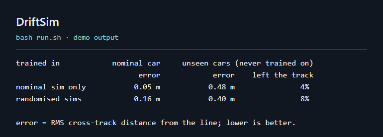
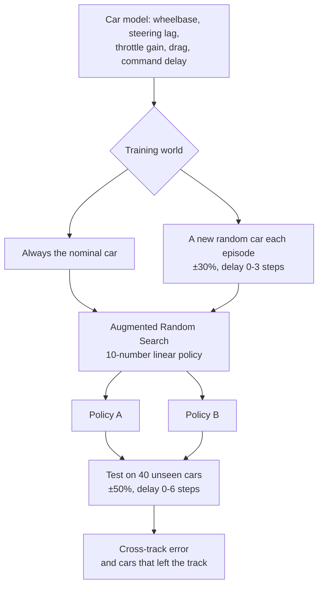

# DriftSim

A simulation study of domain randomization for vehicle path following.

On held-out simulated cars, randomized training reduced mean tracking error from 0.48 m to 0.40 m in the 40-iteration run. Track departures increased from 4% to 8%.

## Quickstart

Compare nominal and randomized training across simulated vehicles held out from training.

```sh
uv sync --locked
uv run --locked driftsim demo
```

Run `bash run.sh` for checks followed by the demo.

[Nominal and randomized training](src/driftsim/experiment.py) · [Simulation and evaluation tests](tests/test_driftsim.py)

## Demo output



## The question

Policies trained purely in simulation often transfer to a real robot with no
fine-tuning, when the simulator was randomised enough that reality looks like
one more random draw. Robotics labs do this with GPU simulators and a few
thousand dollars of hardware.

`driftsim` asks the same question at laptop scale, in about ten seconds:

> If a controller is trained on one perfect car, versus a hundred slightly wrong
> cars, which one copes better with a car that is wrong in ways it never saw?



## Run it

Averaged over 5 training seeds, 40 ARS iterations:

```
trained in            nominal car     unseen cars (never trained on)
                            error            error    left the track
nominal sim only           0.05 m           0.48 m               4%
randomised sims            0.16 m           0.40 m               8%
```

And with 120 iterations (`uv run driftsim run --iterations 120`):

```
nominal sim only           0.04 m           0.33 m               1%
randomised sims            0.07 m           0.29 m               1%
```

## What this shows, and what it does not

- Randomisation gave a **small, consistent gain on unseen cars**: error 12% to
  17% lower in both runs.
- It **costs accuracy on the nominal car** (0.16 m against 0.05 m in the short
  run). A policy that must work for many cars is less sharp for any one.
- It did **not reduce the share of cars that left the track**. With 40 iterations
  it was actually higher (8% against 4%) and with 120 they tied.
- A ten-number linear policy is a weak learner. A richer policy, or a harder
  task, may separate the two strategies further. This is not shown here.
- The unseen cars are drawn from a wider range than training on purpose, so
  they are genuinely out of distribution. That choice sets how much randomisation
  can help, so quote the settings along with the numbers.

Short version: the effect is real but modest in this setup, and it is a trade,
not a free win.

## Fixed-delay stress test

What happens when every test car has a slower actuator response than the controller saw in training? Here the commands arrive five simulation steps (250 ms) late. Nominal training used zero delay and randomized training used zero to three steps. Wheelbase, steering time constant, throttle gain and drag vary independently by up to 30% around nominal during evaluation.

Both strategies trained for 40 iterations at each of five seeds. Each policy faced the same 40 simulated cars and starting conditions (evaluation seeds 10000 through 10039). The table reports mean per-car cross-track RMSE in metres and counts each car that left the track.

| Training seed | Nominal RMSE | Randomized RMSE | Nominal departures / 40 | Randomized departures / 40 |
| ---: | ---: | ---: | ---: | ---: |
| 0 | 0.690 | 1.126 | 0 | 26 |
| 1 | 0.648 | 0.350 | 0 | 0 |
| 2 | 0.749 | 0.409 | 0 | 0 |
| 3 | 0.683 | 0.327 | 0 | 0 |
| 4 | 0.690 | 0.440 | 0 | 0 |

Randomized training lowered tracking error on four of five seeds. The policy trained at seed 0 left the track on 26 of 40 cars. All five nominal policies finished every run on track. Averaging tracking error across seeds hides that failure.

Reproduce the [paired experiment](examples/heldout.py) from the repository root.

```sh
uv run --locked python examples/heldout.py
```

## Where the physics comes from

A kinematic bicycle model with a few non-ideal effects that differ between sim
and reality:

| Parameter | Nominal | Randomised |
|---|---|---|
| wheelbase | 0.30 m | ±30% |
| steering lag | 0.15 s | ±30% |
| throttle gain | 3.0 m/s² | ±30% |
| drag | 0.8 /s | ±30% |
| command delay | 0 steps | 0 to 3 steps (0.15 s) |

Task: follow a sine-wave line at 2 m/s for 10 s. The policy is linear in
[cross-track error, heading error, speed error, wheel angle, 1] and outputs
steering and throttle.

## Limits

- A simplified model: 2D kinematics, no tyre slip. It does not drift, despite the name.
- Nothing here touched a real car. "Unseen cars" are simulated.
- Five seeds is a trend, not proof.

## Layout

```
src/driftsim/car.py          bicycle model, delay, parameter randomisation
src/driftsim/task.py         path, observation, rollout and cost
src/driftsim/ars.py          Augmented Random Search
src/driftsim/experiment.py   the two training worlds and the unseen test set
src/driftsim/cli.py          demo and run
tests/                       15 tests
```

## Credit

Motivated by simulation-to-real work on small wheeled robots that trains
drifting, elevation and visual-navigation policies in simulation and runs them
on a real car without fine-tuning (the WheeledLab project). `driftsim` is a
much smaller independent study and shares no code with it. ARS follows Mania
et al. (2018).

[MIT licence](LICENSE)
